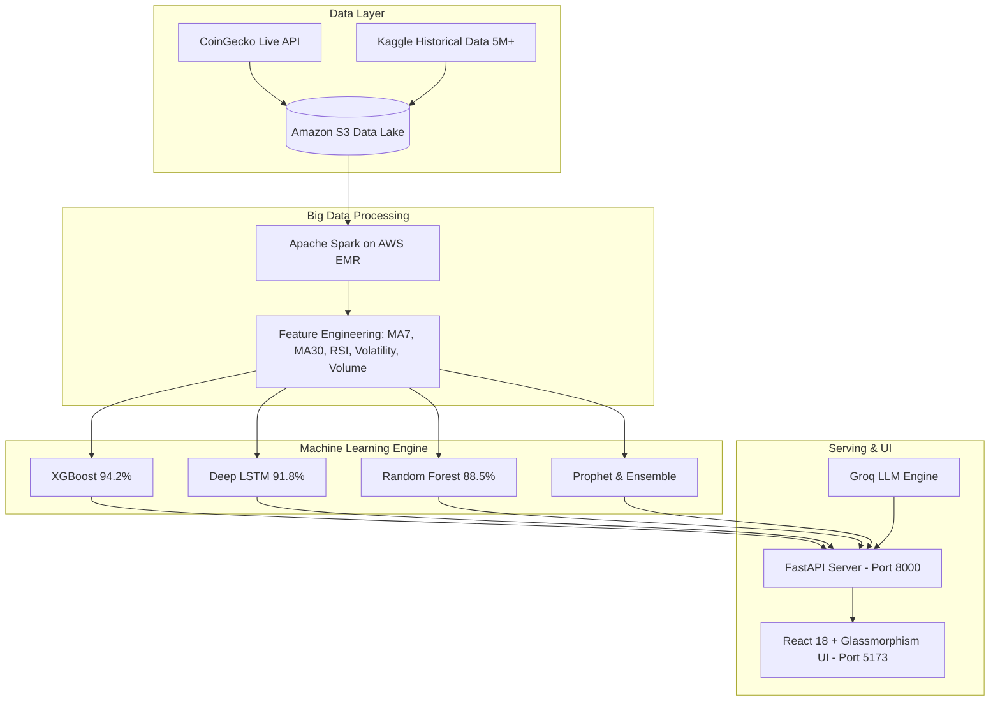

# ⚡ CryptoSpark AI

> **Distributed Big Data & Machine Learning Engine for Cryptocurrency Price Forecasting**  
> *Final-Year Engineering Capstone Project · Academic Research & Production Grade System*

---

[](https://fastapi.tiangolo.com)
[](https://reactjs.org)
[](https://vitejs.dev)
[](https://spark.apache.org)
[](https://aws.amazon.com)
[](https://xgboost.readthedocs.io)

---

## 🌟 Overview

**CryptoSpark AI** ingests and processes **5M+ cryptocurrency trade records** using **Apache Spark on AWS EMR** to compute institutional-grade indicators (Moving Averages, Volume Momentum, Volatility Indices, RSI). 

It benchmarks **4 predictive machine learning architectures** (XGBoost, Deep Multi-Layer LSTM, Random Forest, and Prophet Ensemble) across **BTC, ETH, SOL, and ADA**, streaming real-time predictions via an async **FastAPI** backend to a modern, frosted-glass **React** dashboard.

---

## 🏗️ System Architecture



---

## 📊 Model Leaderboard & Benchmarks

All models are trained and evaluated on a held-out test split of the processed dataset (BTC, ETH, SOL, ADA).

The table below reports **actual test-set metrics** extracted from `models/all_models_comparison.csv`.
> ℹ️ R² > 0.99 is typical for raw price-level regression (predicting P₍ₜ₊₁₎ from Pₜ). Directional accuracy is the more meaningful signal-quality metric for trading decisions.

| Model | BTC R² | BTC RMSE | ETH R² | ETH RMSE | SOL R² | ADA R² |
| :--- | :---: | :---: | :---: | :---: | :---: | :---: |
| **Random Forest** | 0.9933 | $1,853 | 0.9887 | $101.95 | 0.6546 | 0.9815 |
| **XGBoost** | 0.9932 | $1,869 | 0.9875 | $107.21 | 0.6459 | 0.9795 |
| **Linear Regression** | 0.9932 | $1,858 | 0.9888 | $101.78 | 0.7069 | 0.9811 |
| **LSTM** | 0.9924 | $1,887 | 0.9880 | $105.52 | 0.5108 | 0.9780 |
| **Prophet** | 0.9550 | $4,809 | 0.9995 | $20.82  | 0.9960 | 0.9999 |

### Feature Importance (XGBoost, BTC — from `models/btc/feature_importance.csv`)
Features used: 9 normalized OHLCV + derived indicators. No RSI/MACD were included in the training pipeline.
- **norm_high**: `12.7%`
- **norm_hl_range** (High-Low range): `12.1%`
- **norm_low**: `12.1%`
- **norm_ma30** (30-day MA): `12.1%`
- **norm_volatility**: `11.6%`
- **norm_ma7** (7-day MA): `11.1%`
- **norm_prev_close**: `11.1%`
- **pct_change**: `8.7%`
- **norm_open**: `8.5%`

---

## ✨ Key Features

- **Institutional Analytics Dashboard**: Real-time CoinGecko price tickers, interactive timeframe curves (`1D`, `1W`, `1M`, `1Y`), volume momentum distribution, and fear-and-greed sentiment gauges.
- **Interactive ML Playground**: On-demand price simulations across 4 assets and 4 algorithms with quantitative signals (`ACCUMULATE`, `REDUCE`, `HOLD`).
- **AI Explainability Engine**: Plain-English rationale behind model outputs generated via Groq LLM integration.
- **Embedded Assistant**: Conversational assistant trained on project specifications, metrics, and architecture.
- **AWS Infrastructure Telemetry**: Real-time cluster health monitoring for EMR, S3, and EC2 pipelines.

---

## 🚀 Quickstart Guide

### 1. Prerequisites
- **Python 3.13** (recommended)
- **Node.js 18+** & **npm**

### 2. Backend Setup
```bash
# Clone the repository
git clone https://github.com/Parth-1603/CryptoSparkAI.git
cd CryptoSparkAI

# Install Python dependencies
pip install -r backend/requirements.txt

# Configure environment variables
# Edit backend/.env and add your GROQ_API_KEY if using LLM features
```

Start the FastAPI backend:
```powershell
python -m uvicorn backend.main:app --reload --host 127.0.0.1 --port 8000
```
Backend Swagger documentation will be live at `http://127.0.0.1:8000/docs`.

### 3. Frontend Setup
```bash
# From project root:
cd frontend

# Install dependencies
npm install

# Start Vite dev server
npm run dev
```
Open `http://localhost:5173` in your browser.

---

## 📂 Repository Structure

```
CryptoSparkAI/
├── backend/                  # FastAPI Application
│   ├── routes/               # API endpoints (market, predict, metrics, chatbot, explain)
│   ├── utils/                # Feature builders & data helpers
│   ├── model_loader.py       # Fault-tolerant model loader registry
│   └── main.py               # App entrypoint & CORS middleware
├── dataset/
│   ├── raw/                  # Ingested OHLCV raw data
│   └── processed/            # Spark-engineered CSVs (BTC, ETH, SOL, ADA)
├── frontend/                 # React 18 + Vite SPA
│   ├── src/
│   │   ├── components/       # Layout & GlassCard components
│   │   ├── pages/            # Dashboard, Predictions, Metrics, Infrastructure
│   │   └── services/         # Axios/Fetch API client
│   └── tailwind.config.js    # Custom theme tokens & glass effects
├── models/                   # Pretrained weights (.joblib, .keras, .h5)
├── notebooks/                # Research & exploratory data analysis (EDA)
├── results/                  # Generated performance plots & comparisons
└── spark_jobs/               # PySpark ETL & distributed feature pipelines
```

---

## 🔒 Security & Disclaimer

This project is developed for **academic and research purposes only**. Predictive outputs and signals do not constitute financial advice. Always perform independent technical and fundamental analysis before executing financial transactions.
